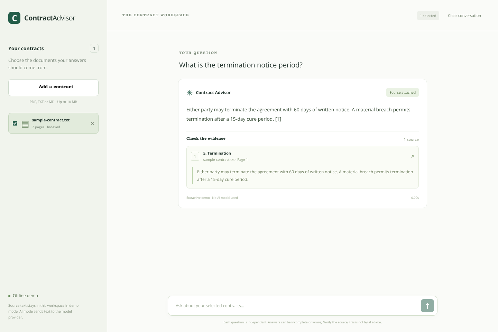
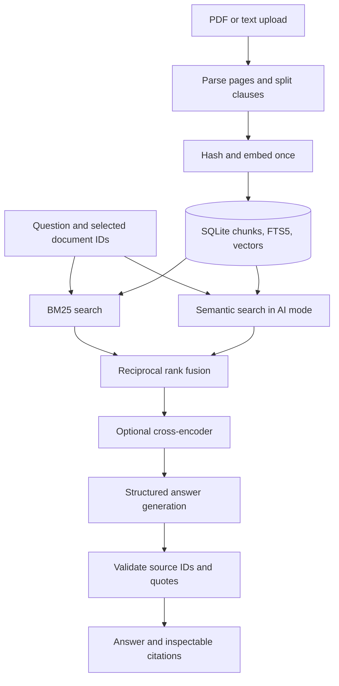

# Contract Advisor RAG

**Ask questions about contracts and inspect the original evidence behind each answer.**

A local portfolio application with a React interface and a FastAPI backend. It ingests PDFs or text once, preserves clause/page metadata, retrieves relevant passages, and returns concise answers with source quotes. A no-key demo makes the project easy to try; OpenAI mode enables semantic retrieval and generated answers.



## What changed in v0.2

| Original prototype | Updated implementation |
| --- | --- |
| One hard-coded PDF, missing from the repository | PDF/TXT/Markdown upload, document selection, public synthetic fixtures |
| PDF parsing and embedding on every question | Persistent index; content and configuration hashes make ingestion idempotent |
| Hypothetical AI answer added to the evidence store | Source contracts are the only evidence; user questions never enter the index |
| Dense retrieval only | BM25 + semantic retrieval, reciprocal rank fusion, optional cross-encoder reranking |
| Flattened text and uncited answers | Page/clause metadata, statement-level evidence references and checked quotes |
| Plain-text GPT-4 response | Configurable model through the Responses API with a typed output schema |
| Non-reproducible evaluation notebook | Shareable QA fixture, explicit retrieval strategies, JSON reports and CI tests |
| Flask + Create React App | FastAPI + React/Vite, validated requests, API docs and browser tests |

## Quick start — no API key

Requires **Python 3.11–3.13**, **Node.js 22.12+**, and SQLite with FTS5 (included in most Python distributions).

Run these commands from the repository root:

If reviewing a downloaded source archive, extract it and skip the clone and `cd` steps.

```bash
git clone https://github.com/mistir-ketema0/Contract_advisor_RAG.git
cd Contract_advisor_RAG
python -m venv .venv
source .venv/bin/activate          # Windows: .venv\Scripts\activate
python -m pip install -r requirements.lock
python -m pip install -e . --no-deps
cp .env.example .env              # Windows: copy .env.example .env
python -m backend.cli examples/sample-contract.txt
uvicorn backend.app:create_app --factory --host 127.0.0.1 --port 8000
```

In another terminal:

```bash
cd frontend
npm ci
npm run dev
```

Open **http://localhost:5173**. Select `sample-contract.txt` and ask: **“What is the termination notice period?”** The demo returns the matching passage with a source reference. You can also upload your own non-sensitive PDF, TXT or Markdown file (up to 10 MiB).

API documentation: **http://127.0.0.1:8000/docs**. The API listens on localhost by default.

> **Demo mode is extractive:** it shows the top keyword-retrieved source passage. It is not a language model and does not establish that a question is answerable. No API calls or model downloads are needed with the default configuration.

## Enable AI and hybrid retrieval

In `.env`, set:

```dotenv
RAG_MODE=openai
OPENAI_API_KEY=your_key
RAG_CHAT_MODEL=gpt-5-mini
RAG_EMBEDDING_MODEL=text-embedding-3-small
```

Restart the backend and ingest your documents again. Existing demo indexes remain separate: the application checks the embedding tag before querying a document. Changing the embedding model or chunk settings requires re-ingestion. Model names are configurable; access and cost depend on your account.

In AI mode:

1. OpenAI embeds source chunks during ingestion and only the question during retrieval.
2. BM25 and dense cosine search each retrieve up to 20 candidates within the selected documents.
3. Reciprocal rank fusion combines the rankings; up to five chunks become generation context.
4. The model returns structured statements and evidence references.
5. The application rejects an answer if a statement lacks evidence, a cited chunk was not retrieved, or a quoted passage cannot be found in that chunk.

**Optional reranking:**

```bash
python -m pip install -e '.[rerank]'
```

Set `RAG_RERANKER=cross-encoder` and restart. Candidates are scored jointly with the question using `cross-encoder/ms-marco-MiniLM-L-6-v2`, then the top five are selected. The first request downloads/loads the model and can be slow. This is a lightweight, general-domain baseline; scores are not calibrated confidence values. The optional dependency/model is not part of the default lock or offline test run.

## Architecture



Chunks use clause boundaries when recognizable and a bounded word window (220 words, 30-word overlap) for long clauses. Page boundaries are preserved. Document name, section and page are added as deterministic retrieval context, not as generated source evidence. This is **metadata enrichment**, not an implementation of LLM-generated contextual summaries.

SQLite keeps the default install small and makes the demo reproducible. Dense search is an exact scan of the selected documents' stored vectors; it is suitable for a small corpus, not millions of chunks. [Design decisions and scale-up path](docs/design.md) describe when to move to a dedicated vector index and background ingestion.

## API

| Endpoint | Purpose |
| --- | --- |
| `GET /health` | Status, mode, embedding tag |
| `GET /documents` | List indexed documents |
| `POST /documents` | Ingest multipart `file`; repeated content/configuration reuses the index |
| `DELETE /documents/{id}` | Remove document metadata, chunks, FTS entries and vectors |
| `POST /chat` | Answer a question using explicitly selected document IDs |

Example request:

```json
{"question":"What is the termination notice period?","document_ids":["<id returned by ingestion>"]}
```

The response contains `answer`, `insufficient_evidence`, `citations` (filename, page, clause and exact quote), retrieval method, stage timings, a request ID, and generation token usage when available. No conversation memory is sent to the model: each question stands alone.

The frontend uses a same-origin `/api` proxy during development. For a hosted build, set `VITE_API_BASE_URL` or configure a same-origin proxy. Configure allowed browser origins with `RAG_CORS_ORIGINS`.

## Evaluation: reproducible, with failures included

The committed [benchmark](benchmarks/synthetic-qa.json) contains **20 synthetic questions**: 16 answerable and four unanswerable, including paraphrases and a question requiring two clauses. A second contract with conflicting terms tests document scoping. The clauses and QA labels are public fixtures, not proprietary legal data.

```bash
python -m backend.evaluation --mode demo --strategy lexical --generate \
  --output reports/demo-evaluation.json
```

The checked-in [demo report](reports/demo-evaluation.json) records configuration, benchmark hash, per-question results, retrieval latency and limitations:

| Metric | Offline demo result | Population |
| --- | ---: | --- |
| Clause Hit@5 | 0.875 | 16 answerable questions |
| MRR@5 | 0.8021 | 16 answerable questions |
| Clause recall@5 | 0.875 | Expected clauses of answerable questions |
| Reference-fragment match | 0.6875 | Extractive answers to answerable questions |
| Unanswerable abstention rate | 0.500 | Four unanswerable questions |

The failures are intentional evidence of remaining work: pure keyword search misses two paraphrased questions, and extraction can return a real clause that does not answer an unsupported question. Fragment matching is a simple regression check, **not semantic answer correctness**. This tiny synthetic set is not a held-out legal benchmark.

Compare retrieval strategies on the same fixture in AI mode (these commands incur embedding costs):

```bash
python -m backend.evaluation --mode openai --strategy lexical --output reports/openai-lexical.json
python -m backend.evaluation --mode openai --strategy dense --output reports/openai-dense.json
python -m backend.evaluation --mode openai --strategy hybrid --output reports/openai-hybrid.json
python -m backend.evaluation --mode openai --strategy hybrid --rerank --output reports/openai-reranked.json
```

Add `--generate` to evaluate generated answers too. These reports should be created from real runs; live OpenAI/reranker scores have not been measured in the default verification. The old notebook remains in `docs/legacy/` as a historical artifact; its input CSVs are missing, so it is not evidence of a reproducible improvement.

For a credible legal-quality evaluation, expand the held-out corpus, label supporting spans, measure citation entailment and unsupported-answer rate, review results with qualified domain experts, and include confidence intervals and cost/latency comparisons. No historic accuracy improvement percentage is claimed.

## Tests and CI

```bash
pytest -q
ruff check backend tests
ruff format --check backend tests
cd frontend
npm run format:check
npm run build
npx playwright install chromium
npm run test:e2e
```

Keep the Python virtual environment activated for browser tests. They start a fresh demo backend and frontend, exercise upload → selection → answer → citation, and check the mobile missing-evidence state. Default tests do not call paid providers; provider adapters and reranking wiring are tested with doubles. GitHub Actions runs backend tests, lint/format checks, the frontend build and browser tests.

## Limitations and privacy

- This is a portfolio prototype for contract reading, not a validated legal-advice system.
- Quote/source validation prevents fabricated references; it does **not** prove that a generated statement logically follows from its quote. Unsupported answers remain possible.
- PDF extraction has no OCR or layout/table reconstruction. The clause splitter uses simple numbered-heading heuristics. Unusual layouts and multilingual contracts need additional parsing/evaluation.
- In AI mode, chunks are sent to OpenAI for embeddings and selected evidence/question are sent for generation. `store=False` disables Responses storage; it does not mean zero provider retention. Review provider policies before using confidential contracts.
- Extracted text and embeddings persist unencrypted in `runtime/`; request logs omit question/contract content. The delete route removes database records, not forensic copies from SQLite files, backups or provider systems.
- The API has no authentication, tenant isolation, rate limiter or malicious-upload sandbox. CORS is not authorization. Keep it local until those controls are implemented.
- Ingestion is synchronous and dense retrieval is linear in the selected corpus size. Optional model downloads and external API requests can fail; failures are surfaced rather than silently switching retrieval modes.

## Repository map

`backend/` contains configuration, ingestion, storage, retrieval, provider adapters, the service, API and evaluation CLI. `frontend/` contains the React/Vite app and browser tests. `tests/` contains backend integration/regression tests. `examples/`, `benchmarks/`, and `reports/` hold shareable fixtures and measured demo results. See [docs/design.md](docs/design.md) for decisions, next steps and supported portfolio claims.

## References

The retrieval design follows documented patterns rather than claiming a universally best RAG architecture:

- [Anthropic: Contextual Retrieval](https://www.anthropic.com/engineering/contextual-retrieval)
- [Qdrant: hybrid queries and reciprocal rank fusion](https://qdrant.tech/documentation/search/hybrid-queries/)
- [Sentence Transformers: retrieve and rerank](https://sbert.net/examples/sentence_transformer/applications/retrieve_rerank/README.html)
- [OpenAI: structured outputs](https://developers.openai.com/api/docs/guides/structured-outputs)

## License

[MIT](LICENSE). Synthetic fixtures are demonstration material and are distributed under the same license.
